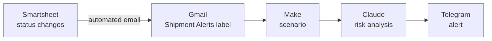
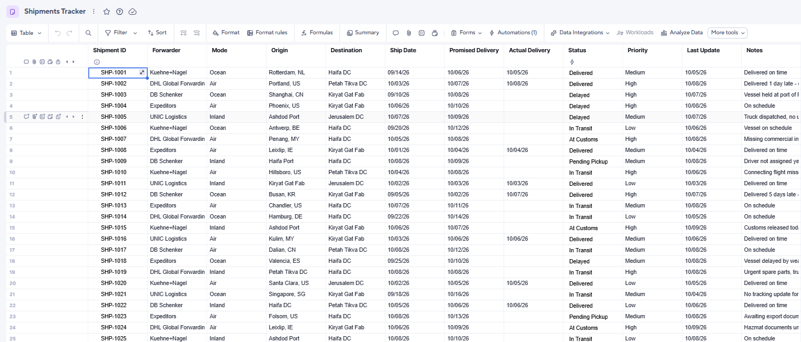
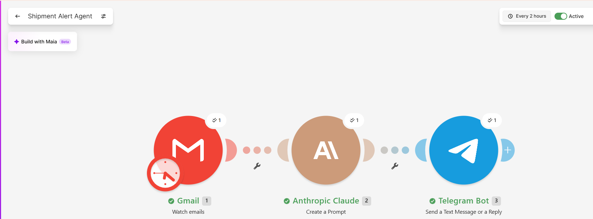
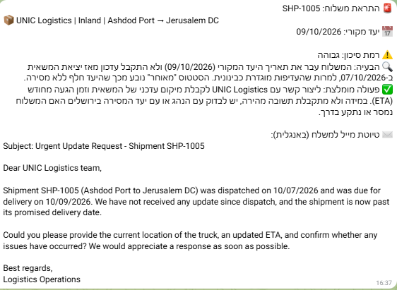

# AI Shipment Exception Agent

An automated AI agent that detects delayed shipments in a Smartsheet tracker, uses Claude to assess risk, recommend corrective actions and draft an email to the freight forwarder, and delivers a real-time alert to Telegram.

Built with **Smartsheet**, **Make**, **Claude (Anthropic API)** and **Telegram**, with no custom code.

🎥 **Demo video:** [Watch the 90-second demo](https://www.loom.com/share/8dcdc5cb34724db4b6956af60cdcef44)

---

## The Problem

A logistics team tracks many shipments at once. Most move on schedule; a few get stuck at customs, miss a flight, or lose tracking updates. The real challenge is not tracking every shipment, but **spotting the problematic ones quickly and acting on them**.

Without automation, someone has to scan the tracker every day, judge how urgent each issue is, and write follow-up emails to forwarders. This agent does that work automatically and hands the coordinator a ready-to-act alert.

## How It Works

1. A shipment's **Status** in Smartsheet changes to `Delayed` or `At Customs`.
2. A Smartsheet automation sends a structured email with all of the shipment's fields.
3. A Gmail filter routes the email to a dedicated **Shipment Alerts** label.
4. A **Make** scenario picks up new, unread emails from that label.
5. **Claude** analyzes the shipment and returns a risk level, the root issue, a recommended action, and a draft email to the forwarder.
6. The result is sent to **Telegram**.

## Example Alert

> 🚨 Shipment alert: SHP-1007
> 📦 DHL Global Forwarding | Air | Penang, MY → Haifa DC
> 📅 Promised delivery: 08/10/2026
>
> ⚠️ Risk level: **High**
> 🔍 Issue: Held at customs due to a missing commercial invoice; the promised delivery date has already passed.
> ✅ Recommended action: Confirm with DHL which documents are missing, obtain the commercial invoice from the supplier in Penang, and update the Haifa DC team on the expected delay.
>
> ✉️ Draft email to the forwarder (ready to review and send)

*(The live alerts are generated in Hebrew; the draft email to the forwarder is in English.)*

## The Role of Each Tool

| Tool | Role | How it is used |
|---|---|---|
| **Smartsheet** | Data source and trigger | Shipment tracker with a dropdown-validated Status column; a workflow sends an email only when Status changes to `Delayed` or `At Customs` |
| **Gmail** | Bridge between systems | A filter routes alert emails to a dedicated label |
| **Make** | Orchestration | Watches the label, passes the email to Claude, sends the response to Telegram; runs every 2 hours |
| **Claude** (Haiku) | Analysis and judgment | Assesses risk using defined rules, identifies the issue, recommends actions, drafts the forwarder email |
| **Telegram** | Notification channel | Delivers the alert straight to the coordinator's phone |

## Key Design Decisions

**1. Rule-based filtering before the AI.**
Deciding whether a shipment needs attention is a simple rule (its status), so it happens at the source, in Smartsheet, at no cost. Claude is only called for what actually needs judgment: interpreting free-text notes, assessing severity and writing the email.

**2. Management by exception.**
Only exceptions generate alerts. Shipments that are on schedule produce no noise.

**3. Data validation at entry.**
The Status column is a closed dropdown list. A typo such as `delayed` or `Delyed` would silently break the trigger, so invalid values are blocked at the point of entry.

**4. Email as an integration layer.**
A direct Smartsheet-to-Make connection requires API access, which is not available on the free plan. Instead, the systems are connected through the channels they already support: Smartsheet sends an email, and Make reads it. This kind of workaround is common in real environments, where legacy and ERP systems often lack direct integrations.

**5. Structured input for the AI.**
The Smartsheet email uses a fixed template with one field per line and no extra formatting. Clean, consistent input makes the AI's output more accurate and reduces token usage.

**6. Human in the loop.**
Claude recommends and drafts; a person reviews and decides. The agent never contacts a forwarder on its own.

**7. Cost versus benefit.**
A small, fast model (Claude Haiku), a capped response length, and a 2-hour polling interval keep the running cost to a fraction of a cent per alert.

## The Prompt

The full prompt is in [`prompt.txt`](prompt.txt). It defines:

- **A role:** a logistics operations assistant.
- **Context:** the input date format and today's date, so the model can tell whether a shipment is already late.
- **A fixed output format:** quick to scan on a phone.
- **Explicit risk rules:** High / Medium / Low, so the assessment is consistent and explainable.
- **Exception handling:** if the notes contradict the status, the agent flags it and recommends verification.

## Repository Contents

| File | Description |
|---|---|
| `README.md` | This document |
| `prompt.txt` | The full prompt sent to Claude |
| `shipments_tracker.xlsx` | Sample dataset: 25 mock shipments with planted exceptions |
| `make-blueprint.json` | Exported Make scenario (credentials removed) |
| `screenshots/` | Smartsheet tracker, workflow, Make scenario and Telegram alerts |

## Screenshots

| Smartsheet tracker | Make scenario | Telegram alert |
|---|---|---|
|  |  |  |

## Possible Improvements

- **Direct API and webhook connection:** with Smartsheet API access, replace the email bridge with an instant webhook trigger and structured row data.
- **Write results back to the sheet:** store Claude's risk level and recommendation in dedicated columns, so the tracker itself shows the current picture. The AI would write only to its own columns, through a service account with minimal permissions.
- **Weekly KPI summary:** an automated report on delay rate, average delay and forwarder performance.

## Related Project

This agent is built on the same architecture as my **AI Job-Screening Agent**, which reads job-alert emails, scores each position against a defined profile with Claude, and sends only relevant matches to Telegram. In that project the AI filters the data; in this one, the filtering happens before the AI, and Claude focuses on analysis and recommendations.

---

**Author:** Noam Paz, Industrial Engineering and Management student, Ruppin Academic Center
